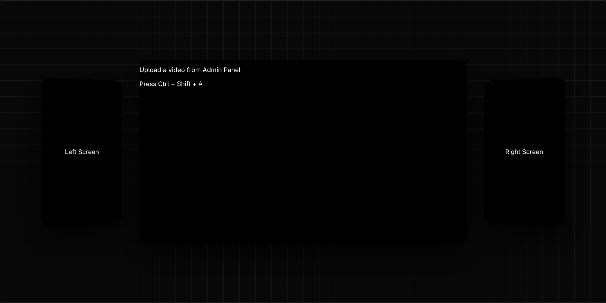

# StageSync




StageSync is a React-based multi-screen video controller designed for stage displays, installations, presentations, and creative video environments.

The application provides three video screens:

- Left screen
- Main screen
- Right screen

Videos can be uploaded directly from the browser and controlled individually or all together through the Admin Panel.

## Features

- Three-screen video layout
- Upload separate videos for the left, main, and right screens
- Play and pause videos individually
- Pause all screens at once
- Resume all screens together
- Muted, looping video playback
- Browser-based video loading using local file URLs
- Admin Panel accessible with a keyboard shortcut
- Responsive React interface powered by Vite

## Admin Panel

To open or close the Admin Panel, press:

```text
Ctrl + Shift + A
```

From the Admin Panel, you can:

- Upload a video to the main screen
- Upload a video to the left screen
- Upload a video to the right screen
- Play or pause each screen separately
- Pause all videos
- Resume all videos

## Tech Stack

- React
- JavaScript
- Vite
- CSS
- HTML5 Video API

## Getting Started

### Prerequisites

Make sure you have the following installed:

- Node.js
- npm

### Installation

Clone the repository:

```bash
git clone https://github.com/tej-sh/stage12.git
```

Move into the project directory:

```bash
cd stage12
```

Install the dependencies:

```bash
npm install
```

### Run the Development Server

```bash
npm run dev
```

Open the local URL shown in your terminal, usually:

```text
http://localhost:5173
```

## Available Scripts

### Start the development server

```bash
npm run dev
```

### Build the project for production

```bash
npm run build
```

### Preview the production build

```bash
npm run preview
```

### Run ESLint

```bash
npm run lint
```

## How It Works

StageSync uses React state to manage the video source for each screen. When a video is uploaded, the browser creates a temporary local URL for that file and displays it in the selected screen.

Each screen has its own video reference, allowing the Admin Panel to control playback independently:

- Main video
- Left video
- Right video

The uploaded videos are stored temporarily in the browser and are not uploaded to a server.

## Project Structure

```text
stage12/
├── public/
├── src/
│   ├── components/
│   │   ├── AdminPanel.jsx
│   │   ├── LeftScreen.jsx
│   │   ├── MainScreen.jsx
│   │   └── RightScreen.jsx
│   ├── App.jsx
│   ├── App.css
│   ├── index.css
│   └── main.jsx
├── index.html
├── package.json
└── README.md
```

## Important Notes

- Videos are loaded locally in the browser.
- Uploaded videos are not permanently saved.
- Refreshing the page will remove the selected videos.
- The application currently does not include user authentication or a backend.
- Browser autoplay restrictions may affect video playback in some environments.

## Future Improvements

Possible future enhancements include:

- Video timeline and seek controls
- Volume controls
- Fullscreen mode
- Persistent video storage
- Cloud-based media uploads
- Synchronized playback timing
- Playlist support
- Touchscreen controls
- Multiple display layouts
- Authentication for the Admin Panel

## License

This project is currently intended for personal and educational use.